# s2-polars-data-analysis

StarCraft II replays as data: [polars](https://pola.rs/) and [DuckDB](https://duckdb.org/)
notebooks over the snapshot that [s2protocol-rs](https://github.com/sebosp/s2protocol-rs)
`write-arrow-ipc` (or [swarmy](https://github.com/sebosp/swarmy)'s Optimize) writes from a
directory of `.SC2Replay` files: one Arrow table per kind of event, partitioned by the day the
games were played.

The notebooks are a course, from level 0 to hero. Every question is answered twice, with polars
expressions and with the equivalent DuckDB SQL over the same files, and a check that both return
the same rows, so each pair is a worked translation between the two. The charts are plotly, the
figures below are their PNG exports from a snapshot of 36,394 replays (2019 to 2026).

## Quick start

```
$ uv sync                                   # Python 3.14, polars, duckdb, functime, plotly, kaleido
$ export S2_IPC_DIR=~/SC2Replays/ipcs       # the snapshot, `ipcs` in the replay directory with swarmy
$ uv run jupyter lab jupyter_notebooks      # open Level_0_Inspect.ipynb
$ uv run plotly_get_chrome                  # optional, once: a Chrome for the PNG exports of the charts
```

Without `S2_IPC_DIR` the notebooks read `~/SC2Replays/ipcs`. The snapshot is written by swarmy
(Optimize a replay directory) or by hand, see [Level 0](./jupyter_notebooks/Level_0_Inspect.ipynb)
and the s2protocol-rs README:

```
$ cargo run --example full -r --no-default-features --features=dep_arrow,dep_tokio,tracing_off -- \
    -v error --timing --source ~/SC2Replays --output ~/SC2Replays/ipcs --cache-path ~/SC2Replays/swarmy \
    write-arrow-ipc --process-max-files 1000000
```

## The DuckDB UI

Every level is also ready in the [DuckDB UI](https://duckdb.org/docs/stable/core_extensions/ui),
a notebook in the browser, with one command:

```
$ S2_IPC_DIR=~/SC2Replays/ipcs uv run python scripts/duckdb_ui.py
```

It creates `data/snapshot.duckdb` with a view over the files of each table and opens
http://localhost:4213. On another machine add `--no-browser` and connect with
`ssh -L 4213:localhost:4213 <machine>`. The views take no space, `--copy` copies the snapshot into
native tables instead, about 5 GB for 36,394 replays and faster for queries that scan the event
tables often. To open the database later with the DuckDB CLI, load the extension first:
`duckdb data/snapshot.duckdb -ui -cmd "LOAD arrow"`.

In a new notebook cell, `FROM examples` lists all the queries, each one is a view:

```sql
FROM level_1.economy;         -- one game, every 7 seconds
FROM level_2.balance;         -- the win rate of each matchup per month
FROM level_3.trends;          -- the slope of each series with its t statistic
FROM level_4.leaderboard;     -- games, win rate and main race of the players
FROM level_5.map_balance;     -- which race each map favors
```

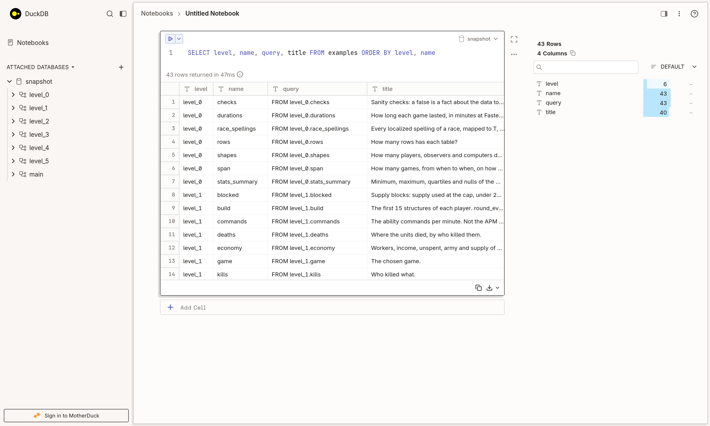
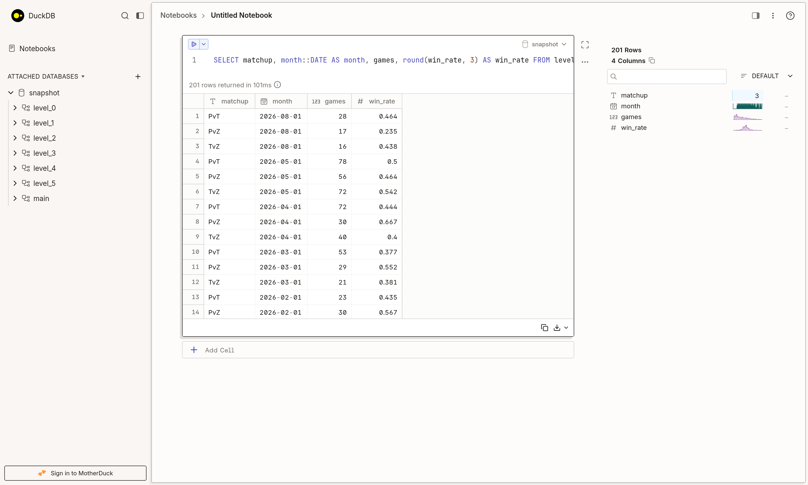
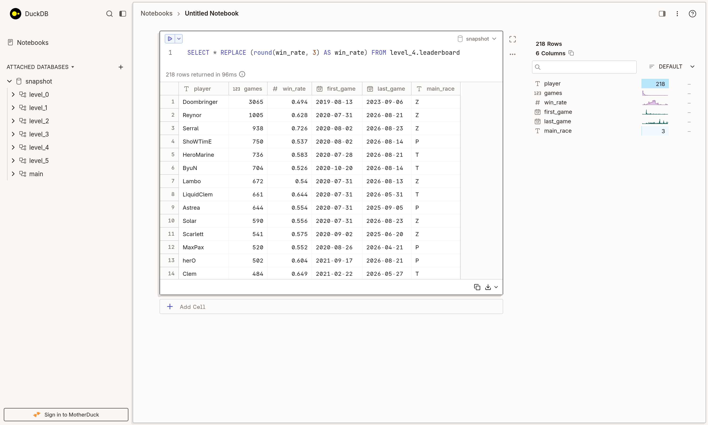

The SQL is in [`sql/`](./sql), one file per level, to read or paste. The game, player and map the
examples follow are views too, change one and the whole level follows:

```sql
CREATE OR REPLACE VIEW chosen_player AS SELECT 'Serral' AS player;
CREATE OR REPLACE VIEW chosen_map AS SELECT 'Ley Lines' AS title;
FROM level_1.economy;         -- now the latest 1v1 of Serral
```

`scripts/check_duckdb_sql.py` checks that each query returns the same rows as its polars frame in
the notebook of the level, and `scripts/duckdb_ui_screenshots.py` retakes the screenshots.

### More DuckDB

[`examples/duckdb_examples.py`](./examples/duckdb_examples.py) shows what DuckDB adds beyond the
equivalents of the levels. `--list` lists them, `--sql <name>` prints the SQL to paste in the UI:

```
$ S2_IPC_DIR=~/SC2Replays/ipcs uv run python examples/duckdb_examples.py asof_join same_person
```

| Example | The question | The DuckDB feature |
|---|---|---|
| `patch_adaptation` | How do the Injects per game follow the patches? | The usage tables per month, no event rows |
| `unit_effectiveness` | Which units kill the most? | The usage tables per year |
| `asof_join` | How many workers and how much army when Stimpack finished, in the wins and the losses? | `ASOF JOIN` |
| `fights` | What were the biggest fights, and where? | Gaps and islands with window functions |
| `same_person` | Which names has one account used? `SHIN`, `Ragnarok`, `WBGSHIN`... | `list(DISTINCT)` on `player_toon_id` |
| `similar_names` | Which names look like the same player? | `jaro_winkler_similarity` |
| `where_do_i_stand` | Ahead of what share of the race at 8:00 is a player? | `percent_rank` |
| `build_order_lists` | Which first four structures are the most played, and do they win? | Lists and slices |
| `macros` | What is a win rate worth, with its 95% interval? | Scalar and table macros |
| `columns_regex` | What does each race lose, per resource and category? | `COLUMNS()` |
| `grouping_sets` | The game length per matchup, per year and in total, in one query | `GROUPING SETS` |
| `pivot` | The game length per year and matchup | `PIVOT`, the columns come from the data |
| `text_histogram` | A chart in a terminal or a cell | `bar()` |
| `sample` | How close is a 1% sample to the exact answer? | `USING SAMPLE` |
| `regular_series` | A monthly series with the gaps explicit, ready for functime | `generate_series`, `IGNORE NULLS` |
| `polars_round_trip` | SQL on a polars frame, then polars on the result | Replacement scans, `.pl()` |
| `export_parquet` | A part of the snapshot to share, 27 MiB of Arrow in 3.6 MiB | `COPY` to partitioned Parquet |

## The levels

| | Notebook | What it teaches |
|---|---|---|
| 0 | [Inspect](./jupyter_notebooks/Level_0_Inspect.ipynb) | What is in the snapshot: the tables, the rows, the columns, the ranges, the sanity checks, `describe` vs `SUMMARIZE`. |
| 1 | [One game](./jupyter_notebooks/Level_1_One_Game.ipynb) | One game minute by minute: workers, income, army, supply blocks, spending quotient, build order, upgrades, fights, who killed what and where, commands per minute. |
| 2 | [Over time](./jupyter_notebooks/Level_2_Over_Time.ipynb) | The same measures over every game, per month: the balance of the matchups, the game length, the workers at 6:00/8:00/10:00 per race, the upgrade timings, the map pool. |
| 3 | [Trends](./jupyter_notebooks/Level_3_Trends.ipynb) | Which series trend and by how much: the slope with its p-value (polars-ds, `regr_slope`), rolling means, functime's feature extractors and forecasters against the naive baseline. |
| 4 | [Players](./jupyter_notebooks/Level_4_Players.ipynb) | The leaderboard, win rates per race, head to head, the economy at 8:00 against the field, commands per minute, favorite openings and units. |
| 5 | [Maps](./jupyter_notebooks/Level_5_Maps.ipynb) | Which race a map favors, how long the games last on it, how fast the players expand, where the units die. |
| hero | [below](#hero) | Full analyses built from these pieces. |

### Level 0: inspect the snapshot

The seven event tables and the aggregations of s2protocol-rs 5.1.0, keyed by `ext_fs_id`; the tracker events identify the players by `player_id`
and `s2.players()` maps them to the names of the details. Before any chart: the row counts, the
schema, the value counts, the ranges and four sanity checks (unique ids, one winner per game, every
game dated, every player mapped), then the first measure of every game, its length.

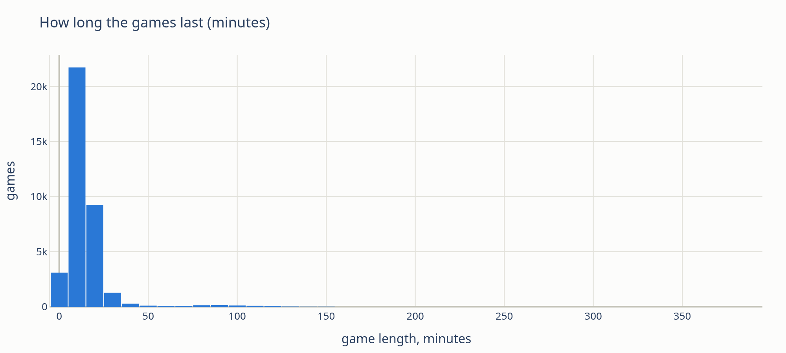

### Level 1: one game, minute by minute

The latest game of the most played player (on your own snapshot: your latest game). The economy
and the army from the stats sampled every 7 seconds, the supply blocks, the
[spending quotient](https://liquipedia.net/starcraft2/Spending_quotient), the first 15
structures of each player side by side, the army lost per minute (the fights), the kills and
where they happened on the map.

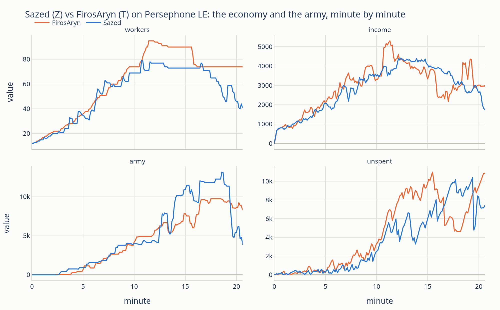
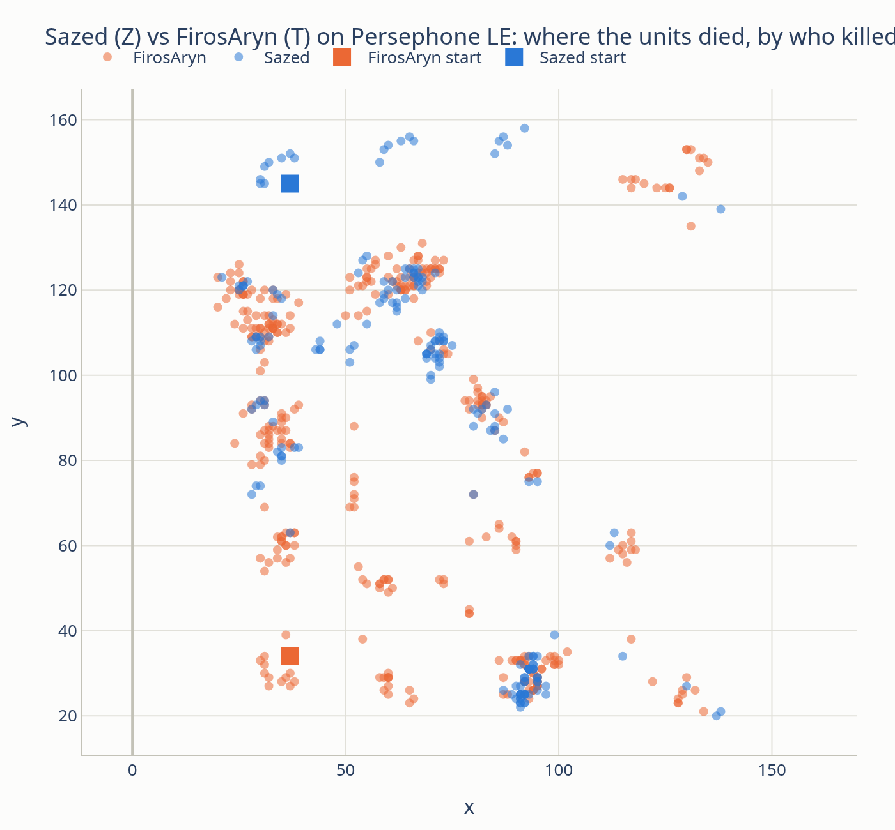

### Level 2: many games, over the months

The measures of Level 1 grouped by the month the games were played: `dt.truncate("1mo")` and
`date_trunc('month')`, the median and a minimum of games per bucket. The win rate of the first
race of each matchup, the median workers at fixed minutes per race, when the upgrades finish, and
the map pool as a heatmap.

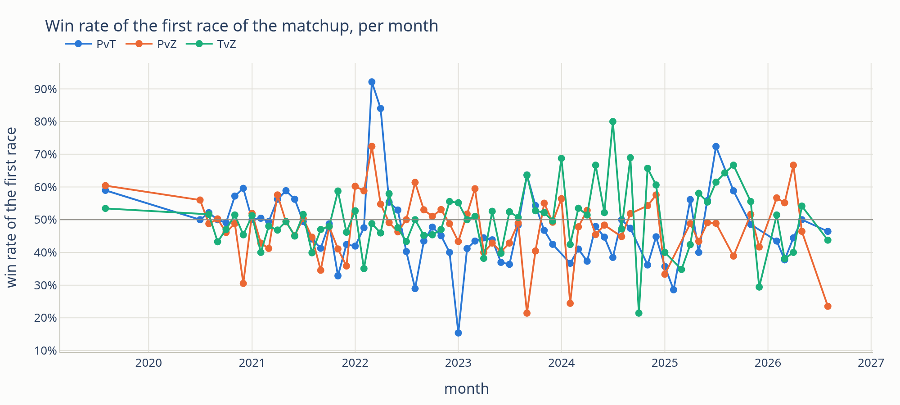
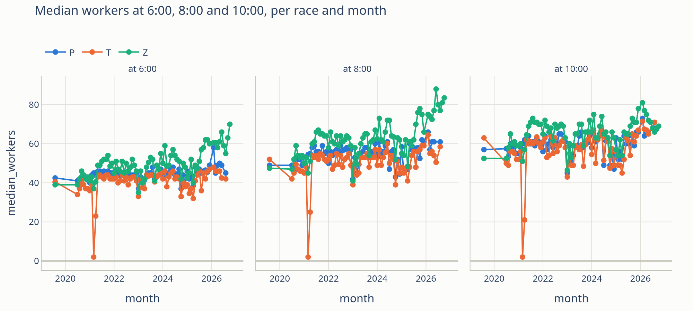

The usage tables of s2protocol-rs 5.1.0 show how the players adapt to the patches, the dashed lines
are the first games of each balance version:

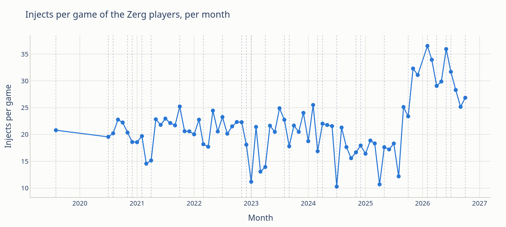

### Level 3: trends

A series of a dozen noisy points has a slope by construction, so the slope comes with its standard
error and p-value (`pds.lin_reg_report`, DuckDB's `regr_slope`), the rolling mean is drawn over
the raw values, and [functime](https://docs.functime.ai/) summarizes each series with its feature
extractors and forecasts the last months with `naive` against a linear model: when the naive
forecast wins there is nothing to extrapolate, which is a finding too.

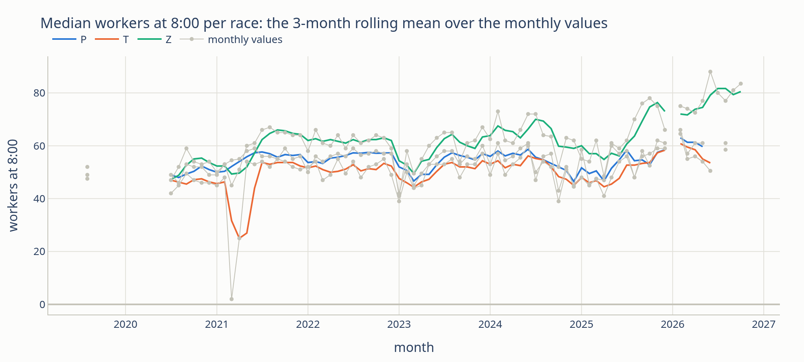

### Level 4: compare the players

The same queries grouped by player: the leaderboard with the main race, the win rate against each
race (`pivot` and `PIVOT`), the head to head matrix, the median income at 8:00 against the field,
the commands per minute, and the favorite opening (`Pylon > Gateway > Assimilator`) and units of
each player, all top-per-group windows (`rank().over()`, `QUALIFY row_number() OVER`).

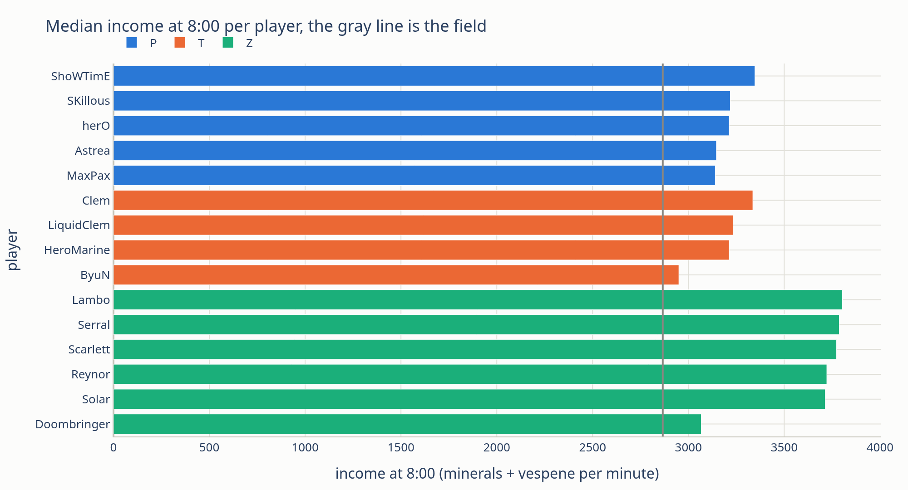
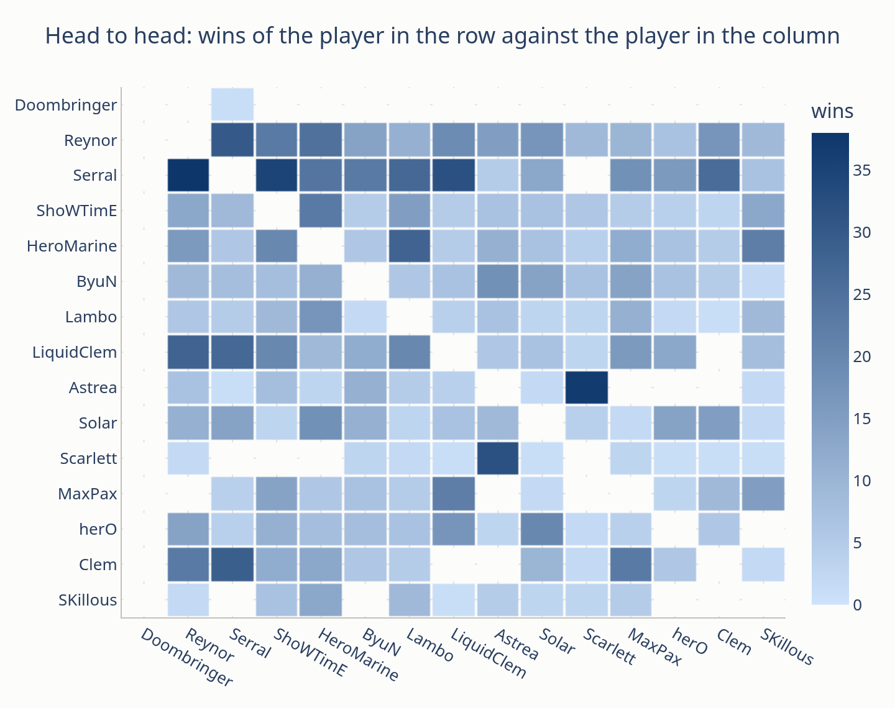

### Level 5: compare the maps

Grouped by map: the win rate of the first race of each matchup as the distance from 50%, the game
length as box plots, the median time of the second and third townhall, and the map as a picture:
the units killed over every game on it, binned in cells, with the spawn positions.

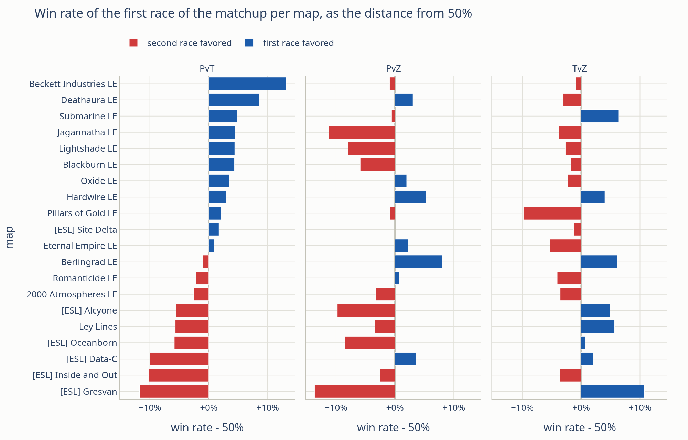
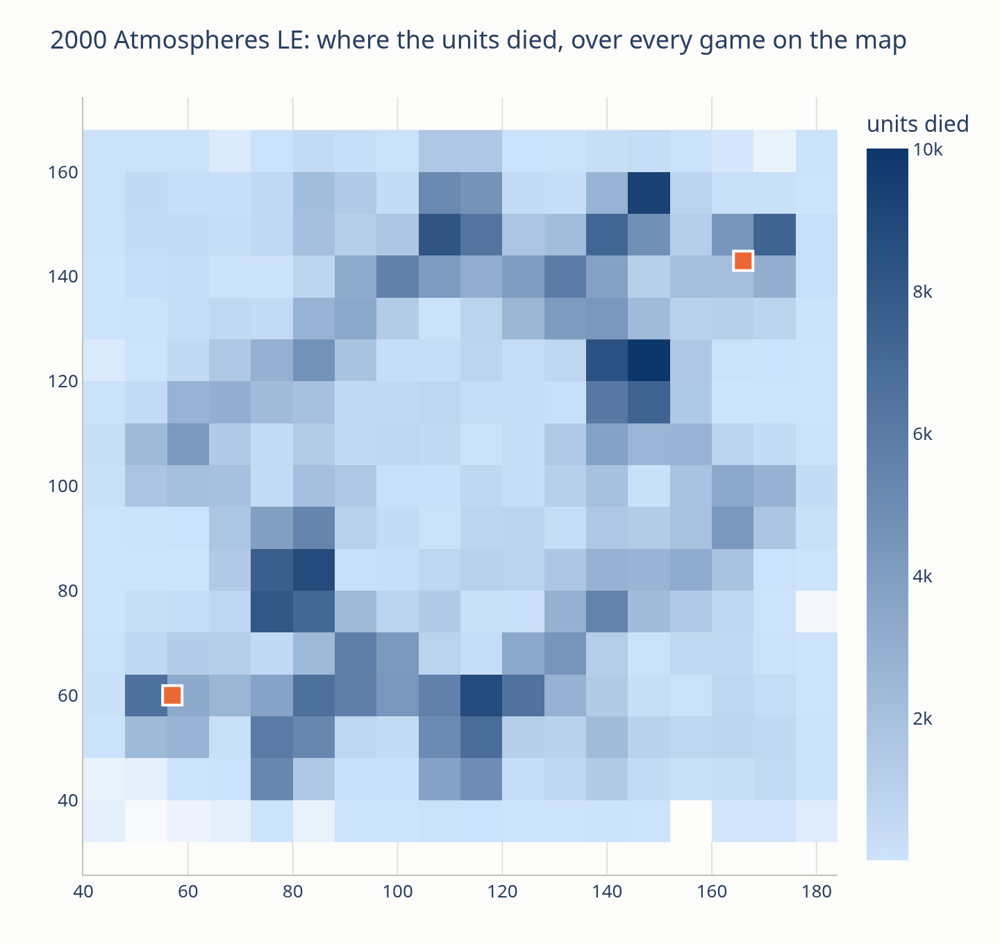

## Hero

Full analyses, each built from the pieces of the levels:

- [functime.ipynb](./jupyter_notebooks/functime.ipynb): forecasting the race balance per week with
  cross-validation, the trend of the upgrade timings, a global model of the workers per minute
  across thousands of games, and the features of the army curves of the winners and the losers.
- [Vs_Cheater_AI.ipynb](./jupyter_notebooks/Vs_Cheater_AI.ipynb): the games of one player against
  two Cheater computers: the openings, the expansions, the economy and the army minute by minute,
  how much the computers cheat (measured), where the losses happen and which measures go with
  winning, by quartile.
- [scripts/win_chance](./scripts/win_chance/README.md): the win chance model of swarmy's Replay
  Detail, fitted on the 1v1 games of a snapshot (army, income, workers, trades per phase,
  calibrated per two minutes).
- [Basic-Unit-Queries.ipynb](./jupyter_notebooks/Basic-Unit-Queries.ipynb) and
  [Exploratory_Data_Analysis.ipynb](./jupyter_notebooks/Exploratory_Data_Analysis.ipynb): the
  first notebooks of the repository, every column of every table commented.
- [reports/SC2 replay analysis levels.md](./reports/SC2%20replay%20analysis%20levels.md): the
  research behind the levels: the metrics the community computes from replays and their sources,
  the DuckDB and polars APIs and pitfalls, functime 1.0 and the headless PNG export.

## The snapshot

`jupyter_notebooks/snapshot.py` reads it, the notebooks import it:

```python
import snapshot as s2

IPC_DIR = s2.ipc_dir()                      # $S2_IPC_DIR, or ~/SC2Replays/ipcs
details = s2.scan(IPC_DIR, "details")       # every day as one LazyFrame
players = s2.players(IPC_DIR)               # each player of each game with its tracker player_id
games_1v1 = s2.one_vs_one(IPC_DIR)          # the players of the 1v1 games with the matchup, i.e. PvT
games = s2.games(IPC_DIR)                   # one row per 1v1 game: winner, loser, matchup, minutes
casts = s2.casts(IPC_DIR)                   # one row per ability command of both cmd files
s2.game_seconds()                           # the game time from ext_replay_loop, 22.4 loops per second

con = s2.duck(IPC_DIR)                      # DuckDB: every table, plus players, games_1v1, games, casts
con.sql("SELECT title, count(*) AS n FROM details GROUP BY ALL ORDER BY n DESC")
s2.same(polars_df, con.sql("..."))          # the same rows, in any order, types allowed to differ
```

The tracker events (stats, upgrades, unit_born, unit_died) identify the player by `player_id`, the
details by name, `players()` maps one to the other through unit_born. The races of the details are
localized, `race` is `T`, `Z`, `P` or `?`. The game commands (`cmd_target_point`,
`cmd_target_unit`) identify the player by `user_id` and `player_name`.

`viz.py` holds the palette (the races and the results keep their colors in every chart) and
`viz.show(fig, name)`, which shows a figure and writes `static/img/<name>.png` and `.html`.

The notebooks are executed headless to refresh their outputs and figures, from
`jupyter_notebooks`:

```
$ S2_IPC_DIR=~/SC2Replays/ipcs uv run jupyter nbconvert --to notebook --execute --inplace Level_0_Inspect.ipynb
```

## Compat

The releases in this repo major version are compatible with the s2protocol-rs major versions.

The notebooks read the snapshot of s2protocol-rs 3.6.0 and later (checked on 5.0.2 and 5.1.0, the
aggregations and the sections that use them need 5.1.0),
partitioned by the day the games were played (`ipcs/year=YYYY/month=MM/day=DD/<file>.arrow`) and
keyed by `ext_fs_id`. Older snapshots (`.ipc` files, `ext_fs_replay_sha256`) must be generated
again, i.e. with swarmy's Optimize.

Example generated reports using the Basic-Unit-Queries:
- [Latest Replay Unit Born including creator ability in Map](https://sebosp.github.io/s2-polars-data-analysis/jupyter_notebooks/static/latest_map_unit_born.html)
- [Latest Replay Map Unit Died in Map](https://sebosp.github.io/s2-polars-data-analysis/jupyter_notebooks/static/latest_map_unit_died.html)
- [Latest Replay Unit Killer to Unit Died Frequency](https://sebosp.github.io/s2-polars-data-analysis/jupyter_notebooks/static/latest_map_unit_killer_to_died_freq.html)
